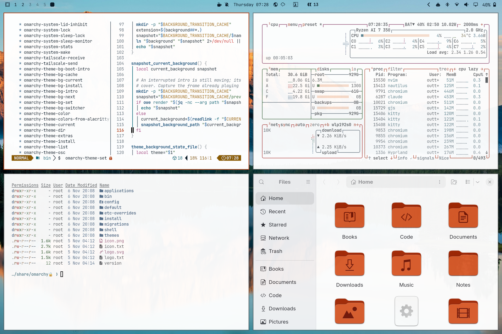
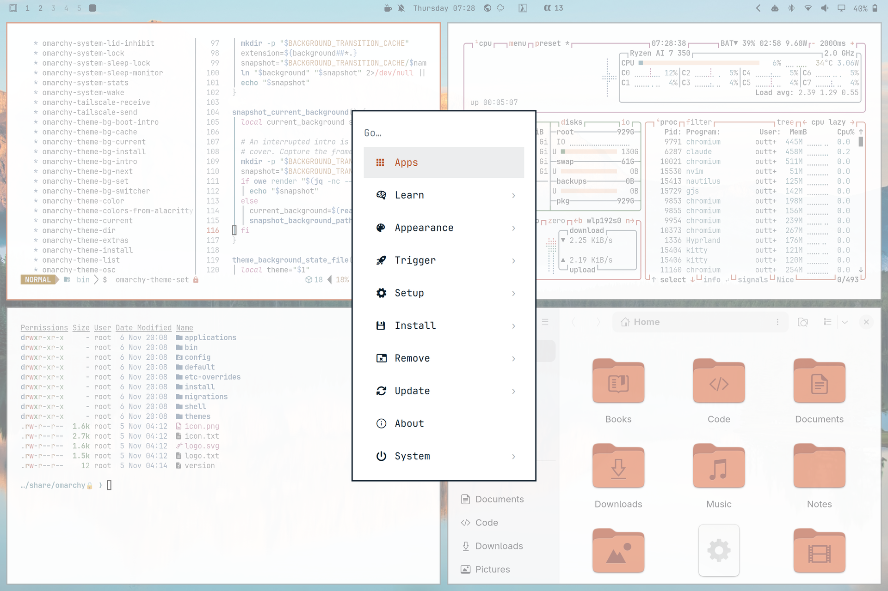
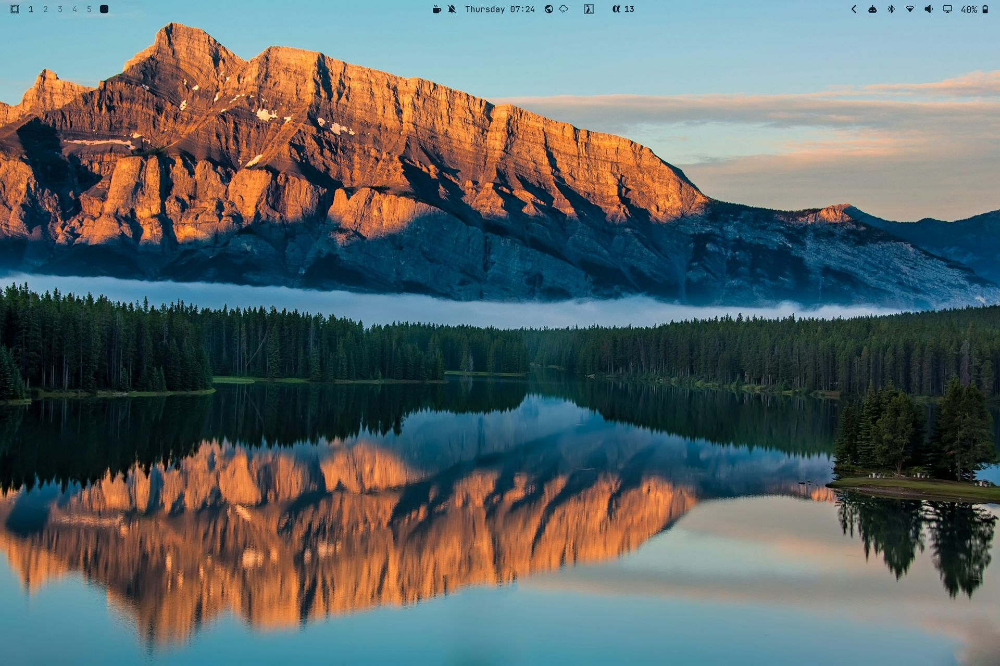

# Alpenglow — Omarchy theme

A high-contrast white theme for [Omarchy](https://omarchy.org), drawn from a sunrise over
Lake Minnewanka in the Canadian Rockies: ink-navy text on pure white, with the orange of
the sunlit rock face as the accent and the lake blues and spruce greens for the terminal.

Every text and terminal color has at least **4.5:1** contrast against the background (WCAG AA);
the main text sits at **17.3:1**.



## Install

```bash
omarchy theme install https://github.com/OuttaSpaceTime/omarchy-alpenglow-theme.git
```

Or from the desktop: `Super + Alt + Space` → Install → Style → Theme, then paste the URL above.

The theme then shows up as **Alpenglow** in the theme switcher.

## Screenshots

The Omarchy menu:



The bare desktop with the Lake Minnewanka background:



## Palette

| Role       | Hex       | Contrast on background |
|------------|-----------|------------------------|
| background | `#FFFFFF` | —                      |
| foreground | `#0A1C2A` | 17.3:1                 |
| accent     | `#B4471B` | 5.4:1                  |
| selection  | `#F6D9C6` | text on it 12.9:1      |
| muted      | `#66737E` | 4.9:1                  |
| red        | `#B3261E` | 6.5:1                  |
| yellow     | `#8A5A00` | 5.9:1                  |
| orange     | `#B4471B` | 5.4:1                  |
| green      | `#2C6B2F` | 6.5:1                  |
| cyan       | `#0E6B7C` | 6.2:1                  |
| blue       | `#0B4F7A` | 8.7:1                  |
| magenta    | `#8E2F6B` | 7.6:1                  |

Everything else (terminals, Neovim, btop, the Omarchy shell, Hyprland borders, the lock
screen, Obsidian, Claude Code, ...) is generated by Omarchy from `colors.toml`.

- Icons: `Yaru` (orange)

## Background

`1-lake-minnewanka-james-wheeler.jpg` is
[**Mountain reflection in Lake Minnewanka**](https://unsplash.com/photos/XuAxyq0uRT0)
by [James Wheeler](https://unsplash.com/@souvenirpixels) on
[Unsplash](https://unsplash.com), taken at sunrise at Lake Minnewanka, Banff National Park,
Alberta, Canada. It is included unmodified under the
[Unsplash License](https://unsplash.com/license). All credit for the photo goes to James Wheeler;
the palette was picked from it.

## License

The theme files (colors, README) are MIT — see [LICENSE](LICENSE). The background photo is
not covered by the MIT license; it remains under the [Unsplash License](https://unsplash.com/license).
